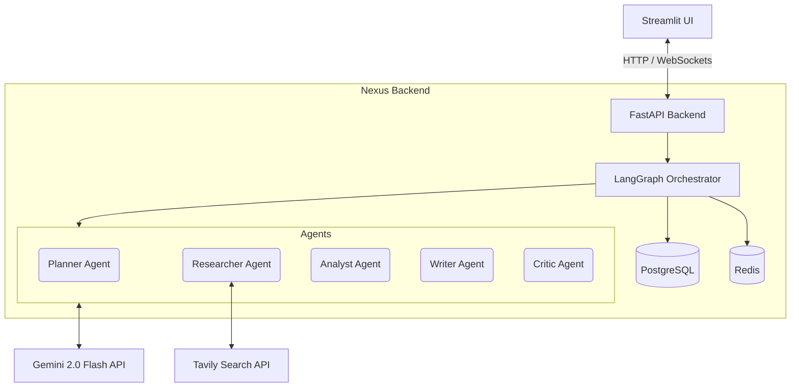
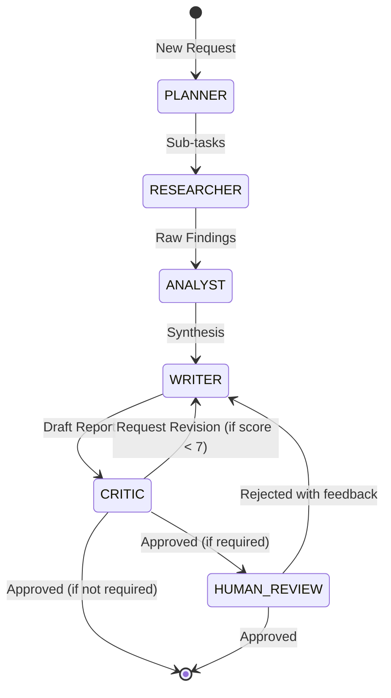

# 🧠 NEXUS — Multi-Agent Research Platform


An enterprise-grade, multi-agent AI research platform that orchestrates specialized agents to autonomously generate publication-quality, heavily-cited research reports.

## 🎯 What is Nexus?
Nexus is a production-ready AI orchestration platform built on LangGraph and FastAPI. It is not a toy chatbot; it is a complex state machine that decomposes tasks, conducts web research, synthesizes information, writes structured reports, and conducts self-critique with human-in-the-loop capabilities. It demonstrates advanced agentic engineering, stateful long-context management, and production AI infrastructure.

## ✨ Key Features
* 🤖 **Multi-Agent Orchestration:** 5 specialized agents (Planner, Researcher, Analyst, Writer, Critic).
* 🔄 **Stateful Workflows:** Built with LangGraph for persistent, fault-tolerant execution.
* 🔍 **Citation Verification:** Every claim is explicitly linked to retrieved web sources.
* 🔁 **Critique & Revision Loops:** Autonomous self-correction and hallucination mitigation.
* 👤 **Human-in-the-Loop:** Optional human approval workflows for critical outputs.
* 📊 **Structured Outputs:** Enforced via Pydantic across all agent boundaries.
* ⚡ **Async Infrastructure:** Fully asynchronous FastAPI backend.
* 🗄️ **Persistent State:** PostgreSQL and Redis integration.
* 🎨 **Premium UI:** Glassmorphism Streamlit interface with real-time WebSocket updates.
* 🐳 **Containerized:** Docker Compose ready for immediate deployment.

## 🏗️ System Architecture



## 🔄 Agent Orchestration Flow



## 🤖 Agent Descriptions

| Agent | Role | Input | Output | Tools Used |
|-------|------|-------|--------|------------|
| **Planner** | Decomposes complex queries into a structured execution plan. | User Query | Sub-tasks, Dependencies | LLM reasoning |
| **Researcher** | Executes search queries, parses documents, and extracts facts. | Sub-tasks | Research Findings, Sources | Web Search, PDF Parser |
| **Analyst** | Synthesizes findings, identifies patterns and contradictions. | Research Findings | Analytical Narrative | LLM reasoning |
| **Writer** | Authors the final report with structured formatting and citations. | Analytical Narrative | Draft Report | LLM reasoning |
| **Critic** | Evaluates the draft for hallucinations, coherence, and accuracy. | Draft Report | Quality Score, Revisions | LLM reasoning |

## 🛠️ Tech Stack

| Component | Technology | Purpose |
|-----------|------------|---------|
| **Orchestration** | LangGraph | State machine, agent routing, conditional logic |
| **LLM Framework** | LangChain | Tool bindings, prompt management, model interaction |
| **Backend** | FastAPI | Async API, WebSockets, background tasks |
| **Frontend** | Streamlit | Real-time tracking, report rendering |
| **Database** | PostgreSQL | Persistent state, report storage |
| **Cache/KV** | Redis | Ephemeral state, rate limiting, caching |
| **Validation** | Pydantic | Structured outputs, schema enforcement |

## 📁 Project Structure
```
nexus/
├── backend/
│   ├── agents/         # Planner, Researcher, Analyst, Writer, Critic
│   ├── api/            # FastAPI routes, WebSockets
│   ├── memory/         # Context management, state persistence
│   ├── orchestration/  # LangGraph state machine, nodes, edges
│   ├── prompts/        # System prompts and templates
│   ├── schemas/        # Pydantic models for I/O
│   ├── services/       # LLM, DB, Cache services
│   └── tools/          # Web search, code execution, parsers
├── frontend/
│   ├── components/     # Streamlit custom UI elements
│   ├── utils/          # API clients
│   └── app.py          # Main UI entry point
└── infra/
    └── docker-compose.yml
```

## 🚀 Quick Start

1. **Clone the repository**
2. **Configure Environment:**
   ```bash
   cp infra/.env.example infra/.env
   # Edit .env and add your GEMINI_API_KEY and TAVILY_API_KEY
   ```
3. **Run with Docker Compose:**
   ```bash
   cd infra
   docker-compose up --build
   ```
4. **Access the App:** Open `http://localhost:8501`

## 🛡️ Engineering Standards
* **Clean Architecture:** Strict separation between I/O, business logic (agents), and orchestration.
* **Structured Outputs:** 100% reliance on structured JSON generation via Pydantic schemas.
* **Async by Default:** `asyncio` used for all API calls, DB queries, and tool execution.
* **Graceful Degradation:** Agents implement fallback strategies if external APIs timeout.

## 🧠 Hallucination Mitigation Strategy
1. **Source-Grounded Generation:** The Writer Agent is strictly prompted to only use information present in the Analyst's output.
2. **Mandatory Citations:** Every claim must have an inline citation linked to a retrieved source.
3. **Adversarial Critique:** The Critic Agent is specifically prompted to act as an adversarial reviewer looking for unsupported claims.

## 🎤 FAQs

**Q: Why use LangGraph instead of standard LangChain agents (AgentExecutor)?**
A: Standard LangChain agents are cyclic and non-deterministic; they decide their next step dynamically, which makes them hard to control in production. LangGraph defines a strict state machine (DAG) where control flow is explicit. This allows us to implement reliable loops (like critique/revision), human-in-the-loop pausing, and strict typing across agent boundaries.

**Q: How do you handle context window limits in long research tasks?**
A: The system implements a `ContextManager` that prunes and summarizes older state. Instead of passing the entire raw HTML of web pages between agents, the Researcher extracts structured `ResearchFindings` (summaries + key points). Only these condensed artifacts are passed to the Analyst and Writer, drastically reducing token usage.

**Q: How is the state passed between agents?**
A: We use a LangGraph `TypedDict` (`ResearchState`) with reducers. For example, the `errors` list uses an `update_list` reducer (appends), while `current_agent` uses an `overwrite` reducer. This state is backed by PostgreSQL via a `MemorySaver` checkpointer, allowing workflows to pause and resume.

**Q: What happens if an LLM outputs malformed JSON?**
A: We use structured outputs natively supported by Gemini/OpenAI APIs. Furthermore, we wrap calls in `tenacity` retry blocks. If parsing fails, the error is caught, and the LLM is re-prompted with the validation error to self-correct.

## 📝 License
MIT

## 📏 Benchmark

`backend/benchmarks/run_benchmark.py` runs the full LangGraph workflow on 10 fixed research queries and
reports success rate, p50/p95 latency, per-agent latency, Critic quality score, first-draft approval rate,
revision loops, citations per report and the Redis cache speed-up. See the docstring for setup.

_Results: coming after the first run._
