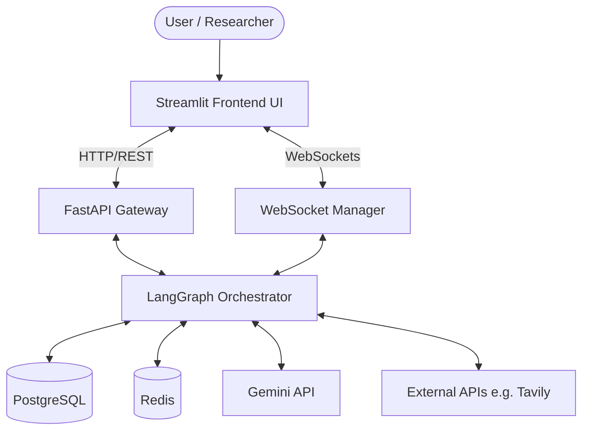
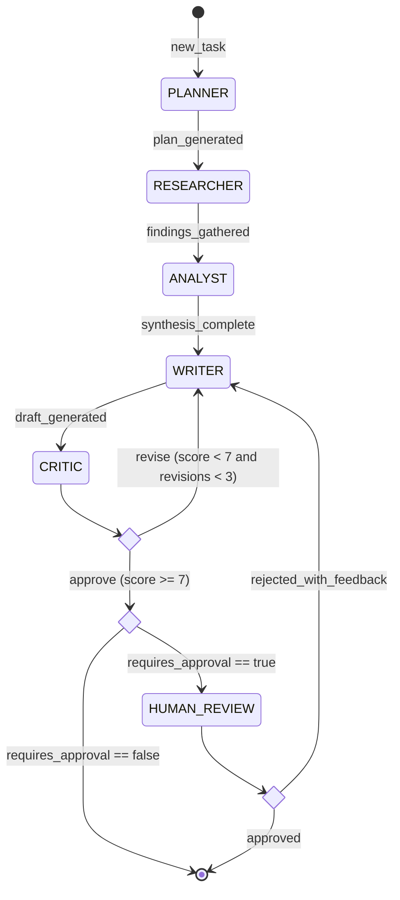
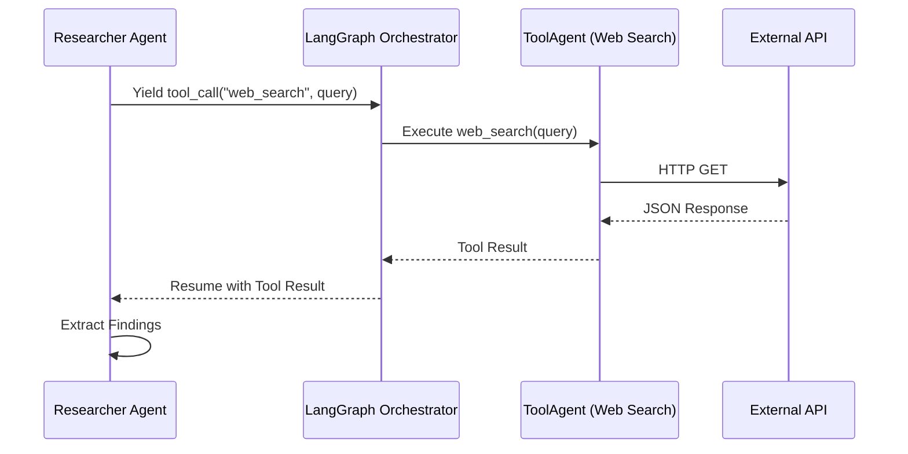
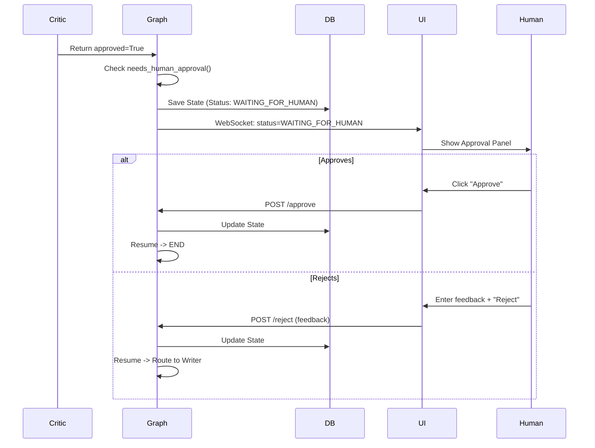

# 🧠 NEXUS — Architecture & Flow Visualizations

## 1. High-Level Architecture
The C4-style diagram showing the system boundaries of the Nexus platform.

## 2. State Machine
Detailed state diagram with all transitions and conditions implemented in LangGraph.

## 3. Tool Integration
How agents call tools and process the results.

## 4. Human-in-the-Loop Flow
Detailed approval/rejection workflow pausing execution.

